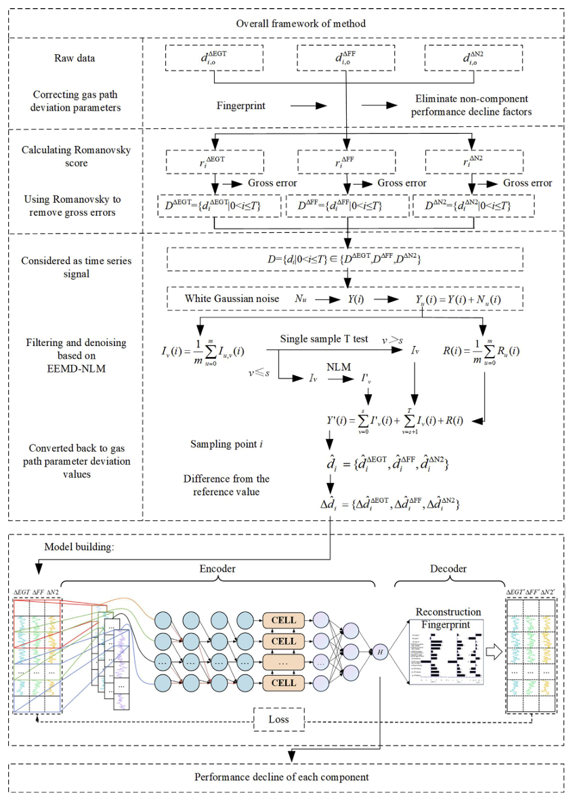
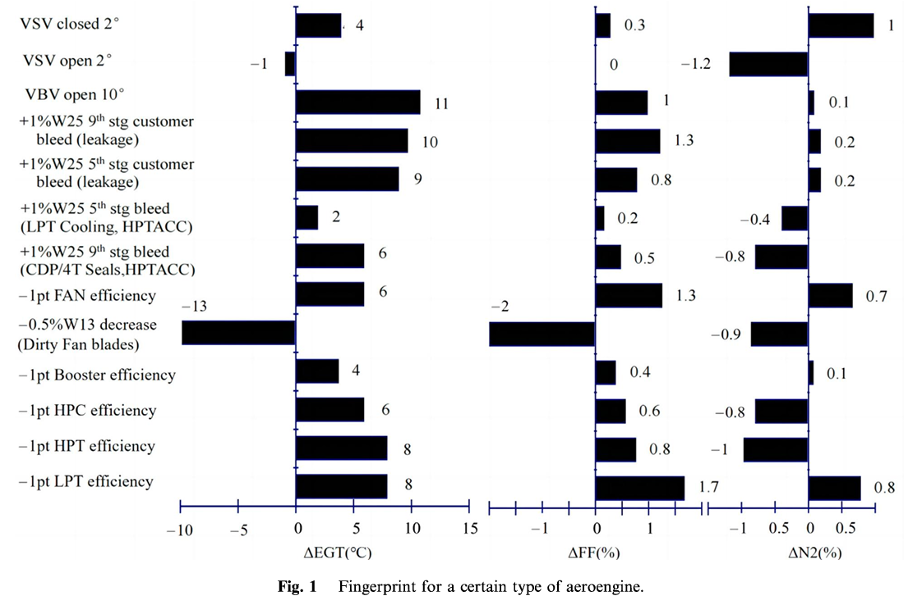
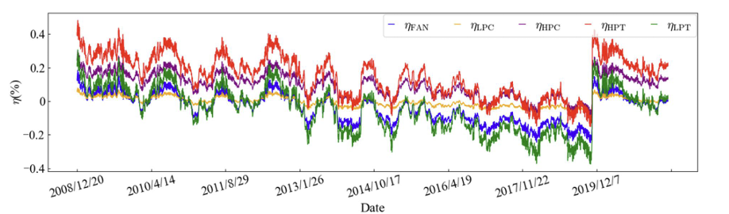
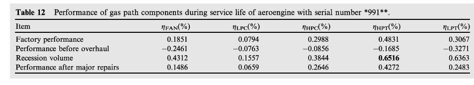
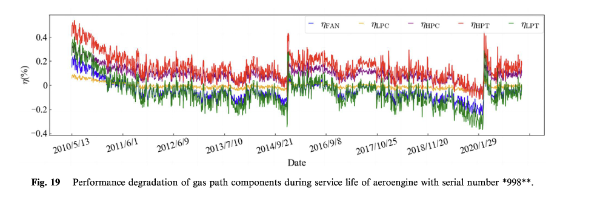
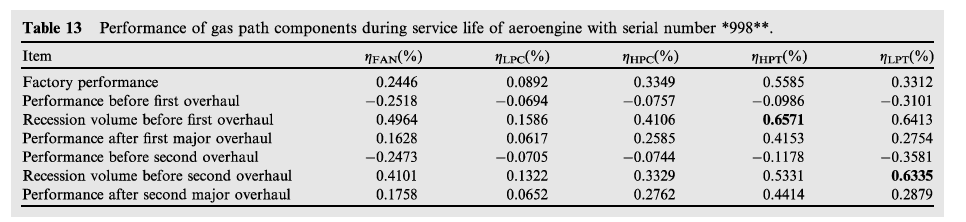

# Knowledge and Data Jointly Driven Aeroengine Gas Path Performance Assessment Method

### 机理知识与数据协同驱动的航空发动机气路多部件性能解耦评估方法

**[English](README.md) | 简体中文**

**Zhe Wang, Xuyun Fu, Rui Zhang, Zhengfeng Bai, Xiangzhao Xia, Wei Jiang**

*Chinese Journal of Aeronautics*, **37**(5), 533–557 (2024)

[论文原文](https://doi.org/10.1016/j.cja.2023.09.011) | [DOI](https://doi.org/10.1016/j.cja.2023.09.011)

---

## 1. 研究概述（Overview）

针对航空发动机气路系统**多部件性能退化相互耦合、监测参数与部件健康状态映射关系复杂，以及传统机理模型依赖设计参数、纯数据驱动方法物理可解释性不足**等问题，本研究提出一种机理知识与运行数据协同驱动的气路多部件性能解耦评估方法。

首先，利用航空发动机气路指印图（Fingerprint）表征部件性能退化与监测参数响应之间的物理关联，修正非部件性能退化因素引起的参数偏移，并结合统计判别与自适应信号分解方法，实现复杂运行数据的误差抑制与退化信息提纯。

在此基础上，将气路多部件性能退化量引入为**具有明确物理意义的隐变量**，构建**机理知识嵌入的非对称编码—解码框架**：通过数据驱动的非线性编码器挖掘气路参数偏差与多部件性能退化之间的复杂映射关系，以指印图所蕴含的部件退化敏感性关系构建物理约束解码器，实现由部件性能退化状态向气路参数响应的机理重构，并通过重构一致性与退化量约束联合引导隐变量学习，实现多部件性能退化的协同辨识与定量解耦。

基于真实航空发动机在役运行数据及典型维修案例开展验证，结果表明，该方法能够有效揭示气路部件的性能演化规律，合理表征维修前后的性能变化，为复杂装备机理与数据融合建模、可解释健康状态评估及精细化运维决策提供技术支撑。

## 2. 核心研究思想（Core Idea）

本研究的核心思想是：

**以机理知识建立物理关联，以数据驱动模型学习复杂映射，以机理重构约束引导物理隐变量学习，实现多部件性能退化的解耦评估。**

区别于完全依赖高精度气路热力学模型的传统机理分析方法，以及缺乏明确物理约束的纯数据驱动方法，本研究将**多部件性能退化量作为连接机理知识与监测数据的关键物理隐变量**，通过非对称编码—解码结构建立气路参数响应与部件退化状态之间的关联。

该框架包含三个相互协同的关键机制：

- **数据驱动编码（Data-driven Encoding）：** 利用深度学习模型的非线性特征表达能力，从复杂耦合的气路参数偏差序列中提取退化信息，建立监测参数响应到多部件性能退化状态的映射关系。
- **机理约束解码（Physics-constrained Decoding）：** 利用气路指印图中蕴含的部件退化敏感性关系，构建具有机理知识基础的线性解码器，将具有物理意义的性能退化隐变量映射回气路参数空间，实现监测参数响应的机理重构。
- **机理引导优化（Physics-guided Optimization）：** 通过气路参数重构一致性与部件性能退化约束，将物理关联引入模型优化过程，引导编码器学习与气路机理知识相协调的部件性能退化表征。

上述过程将数据驱动方法的非线性映射能力与指印图所提供的物理关联相结合，使隐变量不再仅作为抽象的数据特征，而是对应于具有明确工程意义的部件性能退化状态。

## 3. 方法框架（Methodology）

本研究提出的知识与数据联合驱动气路性能评估方法，主要包括**机理知识引导的退化信息提纯、基于物理隐变量的非线性编码，以及指印图约束下的机理解码与联合优化**三个阶段。

<p align="center">
  
</p>
<p align="center"><em>原论文图 2：知识与数据联合驱动的航空发动机气路性能评估总体框架。</em></p>

### 3.1 机理知识引导的气路参数修正与退化信息提纯

针对实际运行数据受到非部件性能退化因素、异常值及随机噪声共同干扰的问题，构建机理知识与信号处理相结合的数据预处理方法。

航空发动机气路指印图表征了部件性能变化、非退化因素与气路监测参数响应之间的敏感性关系。如图 1 所示，不同部件性能退化及运行相关因素会引起排气温度（EGT）、燃油流量（FF）和高压转子转速（N2）的不同响应特征。这些物理关联为气路参数偏差修正与指印图约束下的机理重构提供了知识基础。

<p align="center">
  
</p>
<p align="center"><em>原论文图 1：某型航空发动机气路指印图（Wang 等，2024）。</em></p>

首先，利用航空发动机气路指印图所表征的部件性能退化与监测参数之间的物理关联，对非部件性能退化因素引起的气路参数偏移进行修正。

随后，采用 **Romanovsky 统计判别准则**识别并处理监测数据中的粗大误差，结合**集合经验模态分解（EEMD）与非局部均值滤波（NLM）**方法，实现复杂运行数据的噪声抑制。

通过上述处理，降低非退化因素与测量噪声对性能评估的干扰，提取与气路部件性能演化相关的有效信息。

### 3.2 面向多部件性能退化的非线性编码与物理隐变量表征

针对气路参数偏差与多部件性能退化状态之间复杂的非线性耦合关系，构建基于**动态时序融合网络（DTBN）与多层感知机（MLP）**的数据驱动编码器。

其中，DTBN 融合时序卷积网络（TCN）与长短期记忆网络（LSTM），分别提取气路参数偏差序列的局部时序特征与长期动态依赖，并通过 MLP 学习监测参数与部件性能退化之间的复杂非线性映射关系。

与传统自编码器将隐空间主要作为抽象数据特征表示不同，本研究将**气路多部件性能退化量作为具有明确物理意义的隐变量**，使编码器输出与不同气路部件的性能退化状态建立直接对应关系。

这一设计使数据驱动的特征学习过程与实际工程中的部件健康状态评估建立联系，为多部件性能退化的协同辨识提供基础。

### 3.3 基于气路指印图的机理解码与约束优化

在编码器输出部件性能退化隐变量的基础上，利用气路指印图所蕴含的部件退化敏感性关系构建**物理约束线性解码器**，实现从多部件性能退化状态到气路参数响应的机理重构。

具体而言，解码器利用不同部件性能退化量及其对应的指印图敏感性权重，建立部件退化状态与气路监测参数偏差之间的物理关联。论文中的线性解码结构包含敏感性权重及偏置项。

在模型优化过程中，联合引入两类损失约束：

- **重构一致性约束（Reconstruction Consistency）：** 最小化解码重构的气路参数偏差与实际输入参数偏差之间的差异，使编码器学习到的隐变量受到气路机理关联的约束。
- **部件性能退化约束（Degradation Regularization）：** 利用指印图敏感性权重向量的范数，对不同部件性能退化量进行约束，减小不同部件敏感性差异对模型优化造成的影响。

由此构建融合机理知识与数据驱动学习的 **DTB-AutoEncoder** 性能评估模型。

通过非线性编码、机理约束解码与重构一致性联合优化，将气路监测参数中的耦合退化信息映射为具有物理意义的多部件性能退化表征，实现航空发动机气路多部件性能退化的协同辨识与定量解耦评估。

## 4. 主要研究贡献（Key Contributions）

**（1）提出机理知识与运行数据协同驱动的气路多部件性能评估方法。**

针对传统机理模型依赖发动机设计参数、纯数据驱动方法物理可解释性不足的问题，融合气路指印图机理知识与实际运行监测数据，通过参数偏差修正、异常值抑制及退化信息提纯，为多部件性能退化评估提供具有物理关联的数据基础。

**（2）构建以部件性能退化量为物理隐变量的非对称编码—解码模型。**

将多部件性能退化量引入为具有明确物理意义的隐变量，通过数据驱动非线性编码学习气路参数与部件退化状态之间的复杂映射关系，以指印图敏感性关系构建机理约束解码器，并利用重构一致性与部件退化约束联合引导隐变量学习，实现多部件性能退化的协同辨识与定量解耦。

**（3）基于真实在役数据与典型维修案例验证方法的工程有效性。**

利用真实航空发动机在役运行数据及典型维修案例开展验证，分析各气路部件的长期性能演化规律以及维修前后的性能变化，验证所提方法在实际气路性能评估中的有效性，为可解释健康状态评估与精细化维修决策提供技术支撑。

## 5. 实验验证（Experimental Validation）

本研究基于真实航空发动机在役运行数据及典型维修案例，对所提出的知识与数据联合驱动气路性能评估方法进行验证。

实验重点分析多部件性能退化的长期演化规律，以及维修事件前后的性能状态变化，以检验模型评估结果的工程合理性。

以下图表均来自正式发表的期刊论文。

### 5.1 发动机 `*991**`：单次大修案例

<p align="center">
  
</p>
<p align="center"><em>原论文图 18：发动机 <code>*991**</code> 在役期间的气路多部件性能退化演化。</em></p>

<p align="center">
  
</p>
<p align="center"><em>原论文表 12：发动机 <code>*991**</code> 大修前后的多部件性能评估结果。</em></p>

该案例通过在役运行过程中的性能退化曲线与维修前后的性能评估结果，分析不同气路部件的长期性能演化及大修恢复特征。

其中，高压涡轮（HPT）大修前相对于出厂状态的累计性能衰退量为 **0.6516%**。模型评估的 HPT 性能指标由大修前的 **−0.1685%** 变化为大修后的 **0.4272%**，反映出维修后高压涡轮性能状态的改善。

需要说明的是，0.6516% 表示相对于出厂状态的累计衰退量，并非大修恢复量。

### 5.2 发动机 `*998**`：两次大修案例

<p align="center">
  
</p>
<p align="center"><em>原论文图 19：发动机 <code>*998**</code> 两个大修周期内的气路多部件性能演化。</em></p>

<p align="center">
  
</p>
<p align="center"><em>原论文表 13：发动机 <code>*998**</code> 两个大修周期内的多部件性能评估结果。</em></p>

该案例包含两个不同的服役与维修周期，可用于分析模型对长期性能退化、多部件状态差异及多次维修事件的表征能力。

论文报告，第一次大修前高压涡轮（HPT）的累计性能衰退量为 **0.6571%**，与实际维修记录中高压涡轮存在氧化及侵蚀等现象相吻合。

第二个服役周期内，低压涡轮（LPT）的累计性能衰退量达到 **0.6335%**，表现出较为显著的性能退化特征。

上述真实在役数据与典型维修案例表明，所提出的方法能够合理表征不同气路部件的性能演化及维修前后的状态变化，为多部件性能退化评估提供工程应用依据。

## 6. 论文信息与引用（Publication and Citation）

**论文标题：**

Knowledge and data jointly driven aeroengine gas path performance assessment method

**作者：**

Zhe Wang, Xuyun Fu, Rui Zhang, Zhengfeng Bai, Xiangzhao Xia, Wei Jiang

**期刊：** Chinese Journal of Aeronautics

**发表年份：** 2024

**卷期：** 37(5)

**页码：** 533–557

**DOI：** [https://doi.org/10.1016/j.cja.2023.09.011](https://doi.org/10.1016/j.cja.2023.09.011)

**BibTeX：**

```bibtex
@article{Wang2024Knowledge,
  title   = {Knowledge and data jointly driven aeroengine gas path performance assessment method},
  author  = {Wang, Zhe and Fu, Xuyun and Zhang, Rui and Bai, Zhengfeng and Xia, Xiangzhao and Jiang, Wei},
  journal = {Chinese Journal of Aeronautics},
  volume  = {37},
  number  = {5},
  pages   = {533--557},
  year    = {2024},
  doi     = {10.1016/j.cja.2023.09.011}
}
```

## 7. 代码与数据说明（Code and Data Availability）

论文所使用的真实航空发动机在役监测数据及维修记录未随本仓库公开。

本仓库包含基于论文研究思想的独立算法实现。仓库中的可运行示例使用合成数据，不等同于论文真实在役实验结果的复现。

论文图表均保留原始来源，并受出版方标注的 **CC BY-NC-ND 4.0** 许可及其他适用权利约束。

论文开放获取许可不自动适用于仓库源代码及第三方数据。
